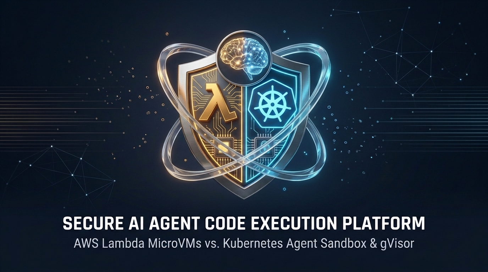

# Secure AI Agent Code Execution Platform: AWS Lambda MicroVMs vs. Kubernetes Agent Sandbox (`mogenius` + `gVisor`)



This repository contains the end-to-end reference architectures, deployment manifests, observability stack, and live engineering benchmarks comparing two approaches to executing untrusted, LLM-generated code securely:

1. **[AWS Lambda MicroVMs (`aws-lambda-microvms/`)](aws-lambda-microvms/):** Snapshot-based Firecracker MicroVMs orchestrated via AWS SAM/CloudFormation, API Gateway, Lambda Control Planes, and dynamic STS session policies.
2. **[Kubernetes Agent Sandbox (`k8s-agent-sandbox/`)](k8s-agent-sandbox/):** Cloud-agnostic Kubernetes sandboxes powered by [`kubernetes-sigs/agent-sandbox`](https://github.com/kubernetes-sigs/agent-sandbox) and the [mogenius Agent Sandbox](https://docs.mogenius.com/agent-sandbox/overview) Helm distribution, isolated with **Google gVisor (`runsc`)**, routed dynamically via NGINX Ingress + `sandbox-router`, and monitored with **Prometheus + Grafana OSS**.

---

## 📖 Articles & Engineering Specifications

* **Part 1 (Published Article):** [🚀 AI agents are writing code. But are our platforms ready to execute it securely?](https://www.linkedin.com/pulse/ai-agenten-schrijven-code-maar-zijn-onze-platforms-klaar-iakym-lynnyk-bbmye/) *(AWS Lambda MicroVMs & Firecracker)*
* **Part 2 (Follow-Up Technical Article):** [I Praised AWS MicroVMs for AI Agents. Then I Built the Exact Same Stack on Kubernetes with gVisor.](docs/FOLLOW_UP_ARTICLE_K8S_VS_MICROVMS.md)
* **Part 3 (Threat Model, Egress Broker & Testkube Security Deep-Dive):** [Beyond Kernel Isolation: Why Egress Control and Zero-In-Guest Credentials Make or Break AI Agent Sandboxes](docs/THREAT_MODEL_EGRESS_AND_CREDENTIALS.md)
* **Functional Specification & Deep Comparison:** [AWS Lambda MicroVMs vs. mogenius (Kubernetes Agent Sandbox)](docs/AWS_LAMBDA_MICROVMS_VS_MOGENIUS_FUNCTIONAL_SPEC.md)
* **Live Demo & Verification Runbook:** [Kubernetes vs. AWS MicroVMs Demo Runbook](docs/DEMO_RUNBOOK.md)

---

## 📁 Repository Structure

```text
.
├── aws-lambda-microvms/                 # Original AWS Lambda MicroVMs (Firecracker) Workshop
│   ├── module-1/                        # Basic MicroVM execution & Port-9000 lifecycle hooks
│   ├── module-2/                        # Event-driven Pull Request code reviewer
│   ├── module-3-ci-runner/              # Scale-to-zero ephemeral CI/CD runner
│   ├── module-4-saas/                   # Multi-tenant SaaS Control Plane & STS Token Vending Machine
│   ├── ci-demo/                         # Sample Python unit-test workload for CI runner demos
│   └── cleanup.sh                       # Teardown script for AWS SAM stacks & MicroVMs
│
├── k8s-agent-sandbox/                   # Kubernetes Agent Sandbox (mogenius + Google gVisor)
│   ├── scripts/
│   │   └── bootstrap_cluster.sh         # 8-stage idempotent cluster reconciler & self-healing bootstrapper
│   ├── helm/
│   │   └── values-mogenius.yaml         # Helm values enabling gVisor RuntimeClass & NetworkPolicies
│   ├── module-1-basic-execution/
│   │   └── launch_sandbox.py            # Sub-second SandboxClaim provisioning & execution script
│   ├── ingress/
│   │   ├── sandbox-router.yaml          # Go reverse proxy routing by X-Sandbox-ID + ServiceMonitor
│   │   ├── sandbox-ingress.yaml         # NGINX Ingress exposing sandbox.127.0.0.1.nip.io
│   │   └── test_ingress_poc.sh          # Automated end-to-end Ingress & routing benchmark script
│   ├── threat-model/
│   │   ├── threat_probe.py              # Zero-dependency in-guest red-team probe (T1-T6 threat vectors)
│   │   ├── egress-broker.yaml           # Out-of-sandbox L7 FQDN Egress & On-the-Wire Credential Broker
│   │   ├── baseline_before_output.txt   # Unhardened baseline probe results
│   │   └── hardened_after_output.txt    # Hardened broker probe results
│   ├── testkube/
│   │   ├── values-testkube.yaml         # Helm values pinning Testkube OSS strictly to worker node minikube-m02
│   │   ├── rbac.yaml                    # ClusterRole & bindings for automated SandboxClaim lifecycle testing
│   │   ├── test-workflow.yaml           # Git-sourced 60 QPS Ingress benchmark & warm-pool latency workflow
│   │   ├── test-workflow-security.yaml  # Continuous red-team security audit & k6 broker fuzzing workflow
│   │   └── tests/
│   │       ├── k6-sandbox-benchmark.js  # 60 QPS rate-limited Ingress benchmark script
│   │       ├── k6-security-audit.js     # k6 SSRF, C2 egress, credential leak & tenant isolation fuzzer
│   │       └── claim_and_measure.py     # Warm pool claim-to-ready latency measurement hook
│   └── monitoring/
│       ├── values-prometheus-grafana.yaml                     # kube-prometheus-stack Helm values
│       ├── monitoring-ingress.yaml                            # Ingress for Grafana UI
│       ├── agent-sandbox-servicemonitor.yaml                  # ServiceMonitor for sandbox controller
│       ├── sandbox-latency-exporter.yaml                      # Exporter for claim latency & T1-T6 security posture
│       ├── grafana-dashboard-agent-sandbox.yaml               # Cluster & Warm Pool Overview Dashboard
│       ├── grafana-dashboard-sandbox-http-responses.yaml      # Dedicated HTTP Responses & Latency Dashboard
│       └── grafana-dashboard-testkube.yaml                    # Testkube 60 QPS & Red-Team Security Dashboard
│
└── docs/                                # Documentation, Articles & Architecture Diagrams
    ├── AWS_LAMBDA_MICROVMS_VS_MOGENIUS_FUNCTIONAL_SPEC.md
    ├── FOLLOW_UP_ARTICLE_K8S_VS_MICROVMS.md
    ├── THREAT_MODEL_EGRESS_AND_CREDENTIALS.md
    ├── DEMO_RUNBOOK.md
    ├── ARTICLE_IMAGES.md
    ├── WORKFLOW_HISTORY.md
    └── images/                          # Architecture diagrams & article cover banners
```

---

## ⚡ Key Architectural & Benchmark Highlights

| Capability / Metric | AWS Lambda MicroVMs (`aws-lambda-microvms/`) | Kubernetes Agent Sandbox (`k8s-agent-sandbox/`) |
| :--- | :--- | :--- |
| **Kernel Isolation** | Firecracker KVM hypervisor per VM (AWS Nitro only) | Pluggable `RuntimeClass`: **Google gVisor (`runsc`)** or **Kata Containers** |
| **End-to-End Allocation Latency** | `1.5s – 3.0s` (`run-microvm` + status poll + JWE auth token) | **`220ms – 410ms`** (`SandboxClaim` bound from `SandboxWarmPool`) |
| **Ingress Proxy Latency** | API Gateway -> Control Plane Lambda -> MicroVM Proxy | **`< 15ms` (`p50 < 5ms`, `HTTP 200 OK`)** via NGINX Ingress -> `sandbox-router` |
| **Container Portability** | Requires custom S3 `.zip` snapshot baking + Port-9000 hook server | Runs **any unmodified OCI/Docker image** (`python`, `code-server`, `opencode`) |
| **Workspace Persistence** | Ephemeral rootfs (8-hour max session; custom S3 sync) | Indefinite **POSIX `PersistentVolumeClaim` (`PVC`)** across `Suspended`/`Running` |
| **Multi-Tenant Credentials** | In-guest `sts:AssumeRole` (exposes parent role to untrusted code) | **Zero in-guest credentials** (`automountServiceAccountToken: false` + host PVC) |
| **Cloud & On-Prem Portability** | Locked 100% to AWS Lambda preview regions | **100% Portable** (EKS, GKE, AKS, OpenShift, bare-metal, local Minikube) |

---

## 🚀 Quickstart

### Option A: Run the Kubernetes Agent Sandbox Stack (Minikube / Any K8s Cluster)
Follow the step-by-step instructions in [`docs/DEMO_RUNBOOK.md`](docs/DEMO_RUNBOOK.md) to:
1. **Provision or Self-Heal the Full 2-Node Cluster:** Run `./k8s-agent-sandbox/scripts/bootstrap_cluster.sh` (works from a fresh `minikube delete` or after a laptop sleep/reboot, reconciling all 8 layers including `minikube-m02`, `gVisor`, Prometheus/Grafana, `egress-broker`, and Testkube OSS).
2. **Run Continuous Red-Team Security & 60 QPS Load Workflows via Testkube:**
   - `testkube run tw agent-sandbox-security-audit -f` *(In-guest `T1`–`T6` threat probe + k6 Egress Broker & tenant isolation fuzzing)*
   - `testkube run tw agent-sandbox-benchmark -f` *(Warm pool claim latency + 60 QPS rate-limited Ingress benchmark)*
3. **Execute Interactive Demo Modules 1–4:** (`SandboxWarmPool`, Ephemeral CI/CD, Multi-Tenant PVC Isolation, `operatingMode: Suspended`, and `kubectl debug`).
4. **Inspect Live Telemetry & Security Posture in Grafana:** (`http://grafana.127.0.0.1.nip.io`, login `admin` / `admin`).

### Option B: Run the AWS Lambda MicroVMs Workshop
1. Ensure AWS CLI and AWS SAM CLI are configured with `lambda-microvms` preview access.
2. Navigate to [`aws-lambda-microvms/`](aws-lambda-microvms/) and run the module deployment scripts (`module-1`, `module-2`, `module-3-ci-runner`, `module-4-saas`).
3. Run `./aws-lambda-microvms/cleanup.sh` to tear down CloudFormation stacks and active MicroVMs.
