# I Praised AWS MicroVMs for AI Agents. Then I Built the Exact Same Stack on Kubernetes with gVisor.

### A hands-on architectural benchmark, a critical security post-mortem on our own STS "Token Vending Machine," and why Kubernetes (`kubernetes-sigs/agent-sandbox` + `mogenius`) won our enterprise evaluation.


In [my previous article](https://www.linkedin.com/pulse/ai-agenten-schrijven-code-maar-zijn-onze-platforms-klaar-iakym-lynnyk-bbmye/) (*"AI agents are writing code. But are our platforms ready to execute it securely?"*), I made a bold claim: **logical isolation in Kubernetes is dead for autonomous AI workloads.**

When an AI agent generates and executes untrusted code—whether it is an autonomous Pull Request reviewer, an ephemeral CI/CD runner, or a multi-tenant SaaS code interpreter—running that code inside standard Docker/Kubernetes containers (`runc`) is an unacceptable security gamble. Because standard containers share the host Linux kernel, a single syscall vulnerability compromises the entire node.

At the time, **AWS Lambda MicroVMs** looked like the undisputed answer. Built on Firecracker hardware virtualization, it promised three game-changing pillars:
1. **Hardware-isolated kernels per tenant** with up to 8-hour stateful sessions.
2. **Snapshot-based rapid resume** (`suspend-microvm` / `resume-microvm`) that seemed to shatter the economics of warm worker pools ($0.00 when idle).
3. **A Dynamic IAM "Token Vending Machine"** that scoped shared S3 access per tenant at runtime using `sts:AssumeRole`.

But in platform engineering, architectural slides and cloud provider demos only tell half the story. To find out whether AWS Lambda MicroVMs truly beat Kubernetes in production, we took our entire [4-module AWS MicroVMs repository](https://github.com/akimchik/aws-lambda-microvms-workshop) and [rebuilt it 1-to-1 on Kubernetes](https://github.com/akimchik/aws-lambda-microvms-workshop/tree/aws-vs-k8s-agent-sandbox-comparison-(1)) using **[`kubernetes-sigs/agent-sandbox`](https://github.com/kubernetes-sigs/agent-sandbox)** (via the **[mogenius Agent Sandbox](https://docs.mogenius.com/agent-sandbox/overview)** Helm distribution), **Google gVisor (`runsc`)**, **NGINX Ingress**, and a full **Prometheus + Grafana OSS** observability stack.

What we uncovered forced us to rethink everything—including a **critical security vulnerability in our own AWS Module 4 architecture**.

---

## 1. Architecture Head-to-Head: How the Two Stacks Map 1-to-1

Both platforms solve the same problem, but from opposite ends of the cloud-native spectrum:

```mermaid
flowchart TB
    subgraph AWS["AWS Lambda MicroVMs Architecture (Proprietary Serverless)"]
        A1["Client Request (X-Tenant)"] --> A2["Amazon API Gateway"]
        A2 --> A3["Custom Control Plane Lambda\n(run-microvm + create-microvm-auth-token)"]
        A3 -->|"X-aws-proxy-auth (JWE)"| A4["Firecracker MicroVM (Nitro Host)\nPort 9000 Hook + Port 8080 App"]
        A4 -->|"In-Guest sts:AssumeRole\n⚠️ Holds Parent IAM Role"| A5["Shared Amazon S3 Bucket\ns3://bucket/{tenant}/*"]
    end

    subgraph K8S["Kubernetes Agent Sandbox Architecture (mogenius + gVisor)"]
        K1["Client Request (X-Sandbox-ID)"] --> K2["NGINX Ingress Controller"]
        K2 --> K3["sandbox-router (Turnkey Go Proxy)\nHTTP & WebSocket Streaming"]
        K3 --> K4["gVisor Sandbox Pod (runsc Sentry)\nZero IAM / K8s Tokens Inside"]
        K5["SandboxWarmPool + SandboxClaim\n(220ms - 410ms Bind)"] -.->|"Pre-warmed"| K4
        K4 -->|"Host VFS Mount"| K6["Dedicated POSIX PVC\n/home/coder/project"]
    end
```



Here is how every proprietary `aws lambda-microvms` CLI primitive maps to declarative Kubernetes Custom Resource Definitions (`agents.x-k8s.io`):

| Operational Function | AWS Lambda MicroVMs (`aws lambda-microvms`) | mogenius Agent Sandbox (Kubernetes) |
| :--- | :--- | :--- |
| **Blueprint / Image** | `create-microvm-image` (S3 `.zip` + AWS snapshot build) | `SandboxTemplate` (Standard OCI/Docker image + `runtimeClassName: gvisor`) |
| **Fast Provisioning** | `run-microvm` (1.5s–3.0s API + JWE token flow) | `SandboxWarmPool` + `SandboxClaim` (**220ms–410ms** claim binding) |
| **State Pause / Resume** | `suspend-microvm` / `resume-microvm` (RAM to S3; 8h max) | `Sandbox.spec.operatingMode: Suspended \| Running` (Frees CPU/RAM, keeps PVC) |
| **Scale-to-Zero Teardown** | `terminate-microvm` / `maxIdleDurationSeconds` | `SandboxClaim` deletion (`shutdownPolicy: Delete`) |
| **Routing & Auth Proxy** | Custom Lambda + `create-microvm-auth-token` (JWE) | Turnkey `sandbox-router` (`X-Sandbox-ID` header or `/sandboxes/<id>` path) |
| **Network Isolation** | `HTTP_INGRESS` & `INTERNET_EGRESS` connectors | Declarative `NetworkPolicy` (Blocks RFC1918 + `169.254.169.254`) |

---

## 2. Plot Twist #1: The Security Flaw in Our AWS "Token Vending Machine"

In Part 1, one of our favorite patterns was **Module 4 (Multi-Tenant SaaS Isolation)**. Instead of creating 10,000 IAM roles for 10,000 tenants, we gave the MicroVM a single broad `TENANT_ACCESS_ROLE_ARN` and wrote a helper inside `aws-lambda-microvms/module-4-saas/tenant-app/app.py` that read the `X-Tenant` header and called `sts.assume_role()` with an inline session policy scoped to `s3://bucket/{tenant}/*`.

When you are running **trusted SaaS backend code** that you wrote yourself, the Token Vending Machine pattern works well.

**But wait: what happens when the workload inside that MicroVM is an AI agent executing untrusted code?**

Look closely at where `sts.assume_role()` runs in `aws-lambda-microvms/module-4-saas/tenant-app/app.py`:
```python
# Runs INSIDE the MicroVM:
sts = boto3.client("sts")
assumed = sts.assume_role(
    RoleArn=TENANT_ACCESS_ROLE_ARN,
    RoleSessionName=f"tenant-{tenant}",
    Policy=json.dumps(scoped_policy) # Scopes to s3://bucket/{tenant}/*
)
```
Because the MicroVM itself possesses the permission to assume the broad `TENANT_ACCESS_ROLE_ARN` *without* a restrictive policy attached at the host boundary, **any untrusted Python or shell script executed by an AI agent inside that MicroVM can simply bypass your `get_scoped_s3_client()` function**, call `boto3.client('sts').assume_role(RoleArn=TENANT_ACCESS_ROLE_ARN)` with no inline policy at all, and exfiltrate **every tenant's data in the S3 bucket**.

### How Kubernetes Solves This with Zero In-Guest Credentials
In Kubernetes Agent Sandbox, security boundaries are enforced **outside** the guest by the host infrastructure across **5 layers of Defense-in-Depth**:
1. **Kernel Interception (`RuntimeClass: gvisor`):** Google's `runsc` Sentry intercepts over 300 Linux syscalls in memory-safe Go userspace. Untrusted processes never touch the host Linux kernel:
   ```text
   $ kubectl -n agent-sandbox exec $POD_NAME -- dmesg | head -n 4
   [    0.000000] Starting gVisor...
   [    0.248910] Generating random numbers by fair dice roll...
   [    0.956987] Creating cloned children...
   [    1.397637] Synthesizing system calls...
   ```
2. **Zero Control Plane or Cloud Credentials (`automountServiceAccountToken: false`):** The sandbox pod contains zero Kubernetes API tokens and zero AWS IAM roles.
3. **Host-Enforced Storage Isolation (`PVC`):** Tenant Alpha and Tenant Beta receive separate host-mounted `PersistentVolumeClaims` mounted at `/home/coder/project`. Untrusted code inside Tenant Alpha’s sandbox has no credential or VFS path to ever reach Tenant Beta.
4. **Strict Network Isolation (`NetworkPolicy`):** Egress to internal corporate networks (`10.0.0.0/8`, `172.16.0.0/12`, `192.168.0.0/16`) and the Cloud Instance Metadata Service (`169.254.169.254`) is blocked at the CNI layer.
5. **Node Taints & Cgroup Quotas:** Sandboxes are confined to tainted `sandbox-workers` node pools with strict `pids.max` limits to neutralize fork bombs.

---

## 3. Plot Twist #2: The Hidden Developer Tax vs. `SandboxWarmPool`

When you build with AWS Lambda MicroVMs day-to-day, three operational friction points quickly surface:

1. **The S3 Snapshot Baking Pipeline:** You cannot simply deploy `image: ghcr.io/my-org/agent-runner:v2`. Every time you update a Python package or system binary, you must zip your build context, upload it to S3, call `aws lambda-microvms create-microvm-image`, and wait minutes for AWS to build and snapshot the VM.
2. **Port-9000 Boilerplate in Every Image:** AWS requires every MicroVM container to run an HTTP lifecycle listener on port `9000` (`GET /health`) alongside your actual application port (`8080`). You cannot run unmodified off-the-shelf images.
3. **8-Hour Hard Session Limit & Ephemeral Disk:** After 8 hours, the MicroVM terminates and any local disk state not manually synced to S3 is wiped.

### What Happens on Kubernetes Instead?
On Kubernetes, `SandboxTemplate` runs **any unmodified OCI container image** (`python:3.11-slim`, `code-server`, `opencode`). And by pairing `SandboxWarmPool` with `SandboxClaim`, we achieved faster end-to-end allocation than our AWS orchestration scripts:

| Benchmark Metric | AWS Lambda MicroVMs | Kubernetes Agent Sandbox (`mogenius` + `gVisor`) |
| :--- | :--- | :--- |
| **End-to-End Sandbox Allocation** | **1.5s – 3.0s** (`run-microvm` + status poll + `create-microvm-auth-token`) | **220ms – 410ms** (`SandboxClaim` binding from `SandboxWarmPool`) |
| **HTTP Proxy Roundtrip Latency** | API Gateway -> Control Plane Lambda -> MicroVM Proxy | **< 15ms (`p50 < 5ms`, `HTTP 200 OK`)** via NGINX Ingress -> `sandbox-router` |
| **Container Image Modification** | Mandatory custom Port-9000 lifecycle HTTP server | **Zero** (runs any standard Docker/OCI image) |
| **Workspace Persistence** | Ephemeral rootfs (max 8h session; requires custom S3 sync) | **Indefinite POSIX `PVC`** (survives `Suspended` -> `Running` cycles) |

---

## 4. Suspending Pods & Live Forensic Debugging (`kubectl debug`)

What happens when a developer closes their laptop, or when a rogue AI agent gets stuck in a suspicious loop?

On Kubernetes, suspending compute to free 100% of CPU and RAM while retaining the user's `git` repository, `.venv`, and `node_modules` is a single declarative patch:

```bash
# Suspend compute (terminates pod immediately, keeps PersistentVolumeClaim intact)
kubectl -n agent-sandbox patch sandbox <sandbox-name> --type='merge' \
  -p '{"spec":{"operatingMode":"Suspended"}}'

# Resume compute (spawns fresh gVisor pod and re-mounts the exact same PVC)
kubectl -n agent-sandbox patch sandbox <sandbox-name> --type='merge' \
  -p '{"spec":{"operatingMode":"Running"}}'
```

And unlike AWS’s black-box Firecracker host—where you cannot inspect cgroup working sets or attach an external debugger outside the guest—Kubernetes gives SREs glass-box **Prometheus + Grafana OSS** dashboards (`sandbox_router_request_duration_seconds_bucket`, `agent_sandbox_claim_controller_startup_latency_ms`) and live ephemeral forensic containers:

```bash
kubectl debug -it -n agent-sandbox <sandbox-pod> \
  --image=nicolaka/netshoot \
  --target=sandbox
```

---

## 5. The CISO & FinOps Reality Check: Public Cloud vs. On-Premises

When presenting both architectures to an Enterprise Architecture board or CISO, two final factors seal the decision:

### 1. FinOps: Retail Serverless Markup vs. Wholesale Node Density
* **AWS Lambda MicroVMs** charge retail per-second serverless rates with a 128MB–512MB minimum per guest kernel—plus hidden taxes for API Gateway ($1.00–$3.50/M requests), Control Plane Lambda invocations, S3 snapshot storage, and CloudWatch Logs ($0.50/GB). (And if you try to self-host Firecracker on EC2, you are forced onto expensive `.metal` instances costing $4,000+/month per node.)
* **Kubernetes + gVisor** runs on standard virtualized nodes (Spot, Savings Plans, or existing on-prem hardware). Because Google's `runsc` Sentry adds only **~15MB–30MB of RAM overhead**, a single 8-vCPU / 32GB RAM node (~$200/month) can pack **80 to 150 concurrent sandboxes**—making it **3x to 6x cheaper** at sustained enterprise volume.

### 2. Data Sovereignty, GDPR, DORA & On-Premises Requirements
* **AWS Lambda MicroVMs** cannot run on-premises, cannot run in air-gapped environments, cannot run on European sovereign clouds, and cannot run locally on a developer’s laptop.
* **Kubernetes Agent Sandbox** is 100% cloud-agnostic. The exact same `SandboxTemplate` and `SandboxClaim` manifests run identically on local **Minikube**, **EKS**, **GKE**, **AKS**, or **on-premises OpenShift / bare-metal**.

---

## 6. Conclusion: Which Platform Should You Choose?

So, were we wrong in Part 1?
* **We were 100% right about the problem:** Standard shared-kernel containers (`runc`) are unsafe for untrusted AI code execution.
* **Where we evolved:** You do **not** have to accept cloud vendor lock-in, proprietary S3 snapshot pipelines, custom Lambda routing glue, or in-guest STS credential risks just to get hardware-grade sandbox isolation.

| Business Scenario | Winner | Why |
| :--- | :--- | :--- |
| **Enterprise with existing Kubernetes (EKS, GKE, AKS, OpenShift)** | **mogenius / K8s Agent Sandbox** | Reuses existing cluster capacity, GitOps, and Prometheus/Grafana; 3x–6x lower FinOps cost at scale via gVisor node packing. |
| **Regulated Industry / On-Prem / Sovereign Cloud / Local Dev** | **mogenius / K8s Agent Sandbox** | AWS Lambda MicroVMs cannot run on-prem or outside AWS. K8s Agent Sandbox runs anywhere—even locally on Minikube. |
| **Interactive Coding Agents, Web IDEs (`code-server`), CI/CD Runners** | **mogenius / K8s Agent Sandbox** | Runs standard OCI images unmodified, persists workspaces on POSIX PVCs across days, and supports WebSockets natively via `sandbox-router`. |
| **Early-Stage Startup (100% Serverless AWS, Zero K8s Team, Low Traffic)** | **AWS Lambda MicroVMs** | Zero cluster management overhead; true $0.00 cost when idle; built-in live RAM checkpointing (`suspend-microvm`) for sporadic workloads. |
| **Hard Regulatory Mandate for KVM Hypervisor Boundary on K8s** | **K8s Agent Sandbox + Kata Containers** | Combines the declarative `SandboxClaim` API and `sandbox-router` of Kubernetes with real Firecracker/Cloud-Hypervisor MicroVMs per pod. |

---

### 🔗 Explore the Code, Dashboards & Benchmarks
All 4 AWS Lambda MicroVM modules, the Kubernetes Agent Sandbox (`mogenius` + `gVisor`) manifests, the NGINX Ingress + `sandbox-router` POC, Prometheus/Grafana dashboards, and the full [Functional Specification](AWS_LAMBDA_MICROVMS_VS_MOGENIUS_FUNCTIONAL_SPEC.md) are available in my GitHub repository:
👉 **[`github.com/akimchik/aws-lambda-microvms-workshop`](https://github.com/akimchik/aws-lambda-microvms-workshop/tree/aws-vs-k8s-agent-sandbox-comparison-(1))**
